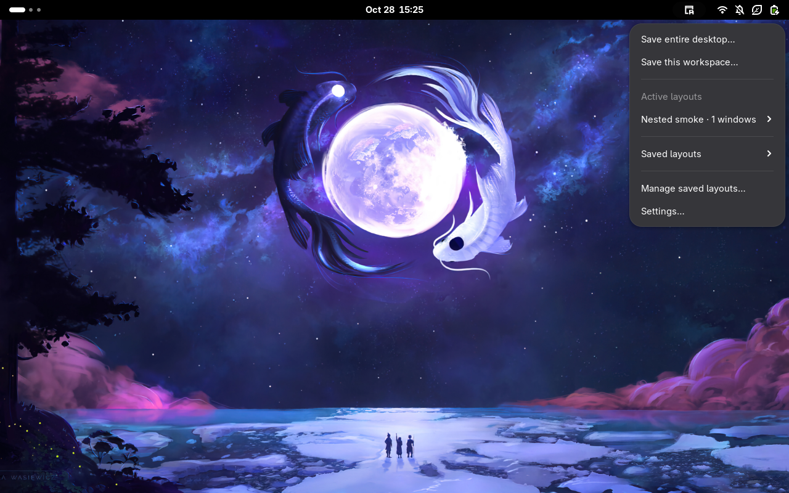
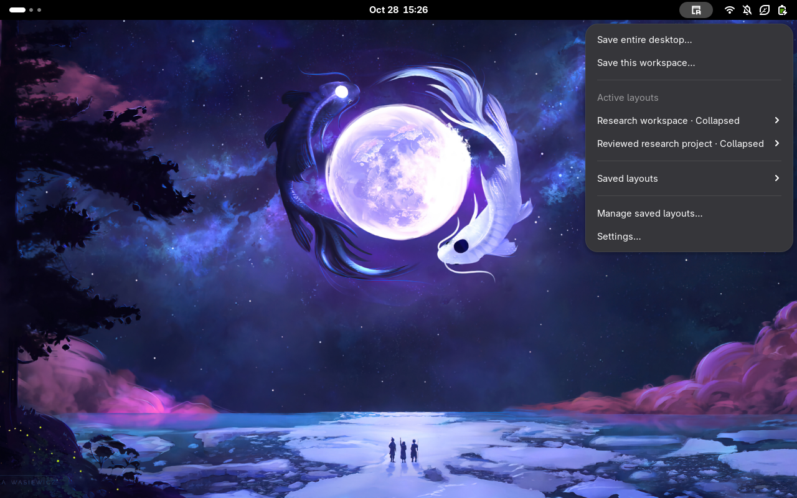
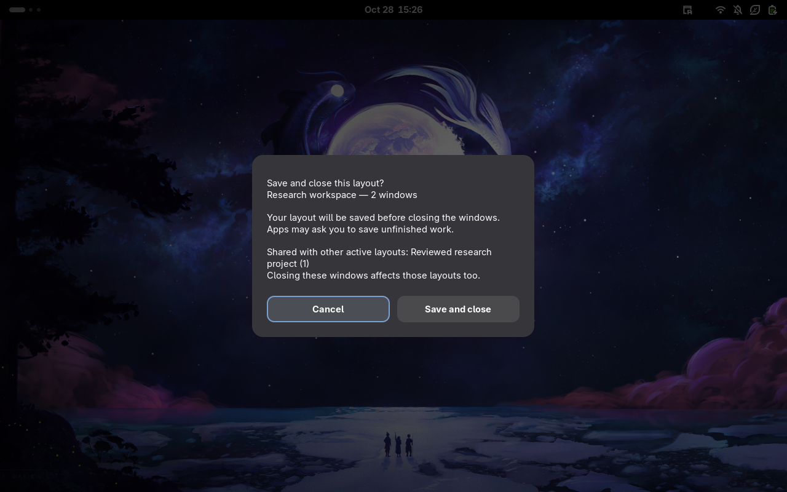
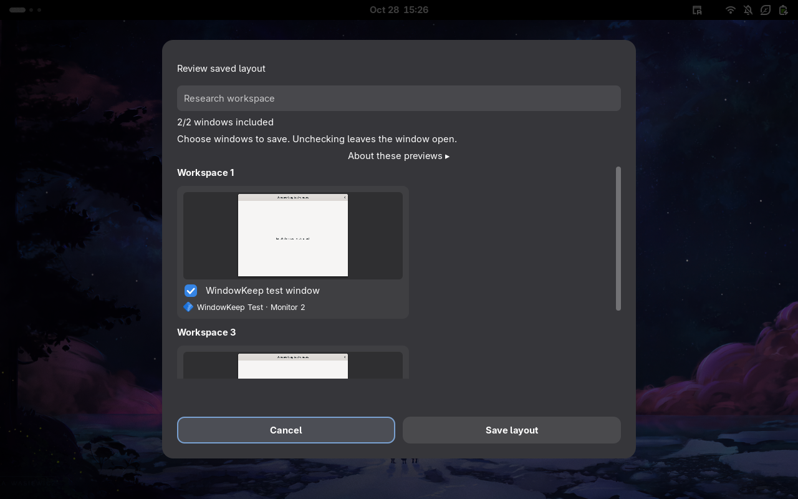
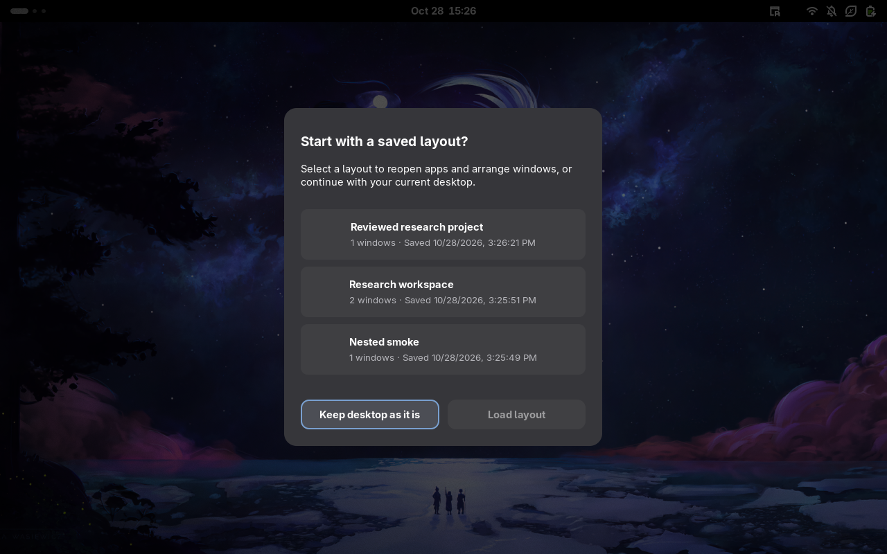
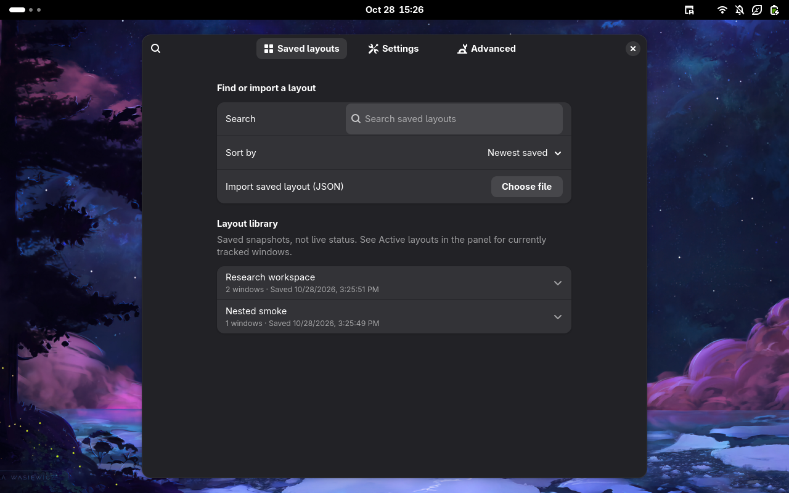
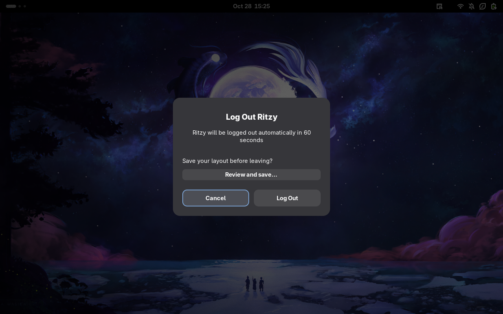
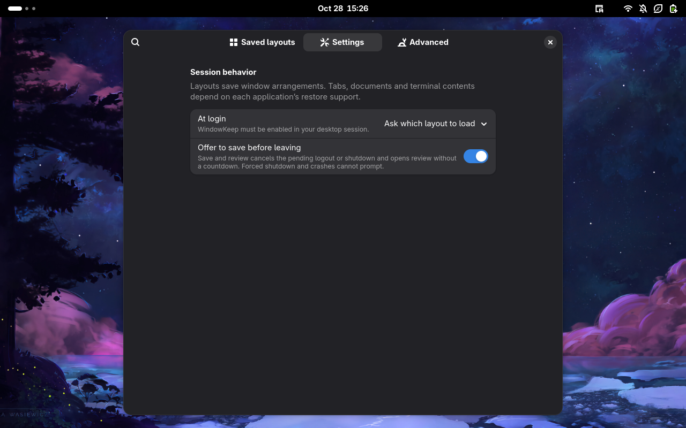
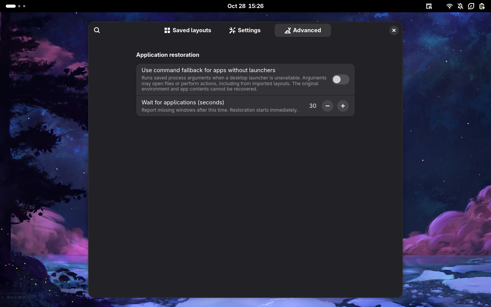

# WindowKeep

**Save your workspace. Pick up where you left off.**

| **Overview — features and screenshots** | [Architecture — code and design](docs/ARCHITECTURE.md) |
| :--- | :--- |

WindowKeep is a GNOME Shell extension for saving window arrangements across
workspaces and monitors. Keep named layouts for different projects, choose what
to include, and restore them from the top panel.

**GNOME 50 · Wayland · GPL-3.0-or-later**

> WindowKeep restores window arrangements. Browser tabs, documents, unsaved work
> and terminal contents depend on each application's own save and restore support.

## Your layouts, in one place

Open the window-and-save icon in the top panel to capture your entire desktop or
just the current workspace. **Active layouts** shows layouts with tracked open
windows; **Saved layouts** keeps inactive layouts in a collapsed dropdown.



| Action | What happens |
| --- | --- |
| Save entire desktop… | Captures windows across workspaces and monitors, then opens review. |
| Save this workspace… | Captures the current workspace's windows, then opens review. |
| Collapse | Minimizes a layout's windows. Apps keep running and using resources. |
| Resume | Reveals and restores a collapsed layout. Missing apps may be reopened. |
| Save and close… | Saves first, then requests normal window closes. You handle any unsaved-work prompts. |
| Load a saved layout | Reuses matching windows, launches missing apps, and attempts to restore their arrangement. |

### Collapse and Save and close






Shared windows are flagged before closing. WindowKeep never force-kills apps.
New windows are not automatically assigned to a project; save a fresh layout to
include them. Multiple layouts may be active at once.

## Review before saving

1. Choose **Save entire desktop…** or **Save this workspace…**.
2. Give the layout a name.
3. Review live previews grouped by workspace. Uncheck windows you do not need.
4. Choose **Save layout**.



Unchecking a window leaves it open. Previews stay in memory; WindowKeep does not
save screenshots of your windows. When a preview is unavailable, an app icon and
fallback label are shown. Individual browser tabs cannot be selected separately.

## Choose how to start your session

At login, select a saved layout and choose **Load layout**, or choose **Keep
desktop as it is**. Selecting a row alone does not launch applications.



The **At login** setting has three choices: **Do nothing**, **Ask which layout
to load**, and **Restore last layout**. The extension must be enabled for login
behavior to work.

## Find and manage saved layouts

Search by name and sort by newest saved, oldest saved, last modified, or name.
Expand a layout to rename, duplicate, export or delete it. Import accepts local
JSON files and creates a new layout rather than overwriting an existing one.



Dates and window counts help distinguish similar layouts. IDs are available under
**Technical details**, rather than filling the main list. This library contains
saved snapshots; live activity is shown in the panel's **Active layouts** section.
Older layouts use their saved date for sorting until modification tracking is
available from an edit.

## Save before leaving

Enable **Offer to save before leaving** for a reminder in GNOME's logout,
restart and shutdown confirmation. **Review and save…** cancels the pending exit
and opens the standalone review without a countdown. After saving, choose **Done**
or explicitly continue with logout, shutdown or restart.




The reminder asks **“Save your layout before leaving?”**. Choose **Review and
save…** to select windows first, or use GNOME’s normal exit button to leave
without a new WindowKeep save.



Closing the review does not log you out. A new save never overwrites an earlier
layout, even when the name matches. Power loss, forced shutdown and commands that
bypass GNOME's confirmation cannot show the reminder.

## Advanced restoration options

**Wait for applications** controls how long WindowKeep waits before reporting
missing windows. It does not delay the start of restoration. A partial result
names unresolved windows; it does not keep relaunching them blindly.



**Command fallback** is optional and disabled by default. It allows saved process
arguments to run when no desktop launcher exists. Those arguments may open files
or perform actions. Imported layouts discard process commands and use installed desktop launchers. They cannot reproduce the
original working directory, environment or application memory.

## Install

You need **GNOME Shell 50 on Wayland**. Build tools are `make`, Python 3, Node.js,
GJS and GLib schema tools. There are no npm dependencies; Python is development
tooling, while the extension and runtime CLI use GJS.

From your checkout:

```bash
make pack
gnome-extensions install --force "$PWD/dist/windowkeep@rithakith.github.io.shell-extension.zip"
```

Save your work, **log out and back in**, then enable WindowKeep:

```bash
gnome-extensions enable windowkeep@rithakith.github.io
```

If you used the earlier Session Atlas builds, disable the old ID before enabling
WindowKeep. Existing saved profiles and preferences are preserved through the
compatibility paths and settings migration.

### Earlier development IDs and troubleshooting

Run the command for the old copy you installed:

```bash
gnome-extensions disable session-atlas@ritzy
gnome-extensions disable session-atlas@rithakith.github.io
```

If GNOME says the new extension does not exist immediately after installation,
log out of the desktop session—not just lock it or close the terminal. GNOME
Wayland cannot reload Shell through Alt+F2 → `r`.

```bash
gnome-extensions info windowkeep@rithakith.github.io
gnome-extensions prefs windowkeep@rithakith.github.io
```


## Capabilities and limits

- **Best-effort matching:** same-app windows with identical or changed titles
  may be difficult to associate with their original layout entries.
- **Monitor changes:** relative geometry helps with changed resolutions; missing
  monitors fall back to primary with a warning.
- **Workspace policy:** secondary-monitor windows remain visible across workspaces
  when GNOME restricts workspaces to the primary monitor. They are still captured.
- **Native tiling:** half-screen arrangements restore as geometry; Mutter tile
  linkage is not recreated. Apps may impose minimum sizes or refuse placement.
- **App content:** tabs, documents, unsaved work and terminal processes require
  application support. Dialogs cannot be launched independently.
- **No continuous autosave:** save or review a layout explicitly. Collapsing apps
  does not suspend them; closing windows may leave background processes running.

This first release targets GNOME 50. It has not yet been approved on GNOME
Extensions. Automated checks run against GNOME 50.5 with two virtual outputs. Physical monitor,
Flatpak and real-login acceptance work remains documented in the
[manual test matrix](docs/TESTING.md).
Screenshots above are actual renders from the isolated test desktop, using test
applications rather than personal windows.

## Privacy, automation and contributing

Profiles are plain JSON under `~/.local/share/session-atlas/profiles/`, respecting
`$XDG_DATA_HOME`. The historical directory keeps existing layouts accessible.
New directories use `0700`, and profile writes use `0600` with atomic replacement.
Titles and saved command arguments may contain private information: inspect and
redact exported layouts before sharing. There is no telemetry or networking code.

For automation, use `scripts/windowkeep`; see the [CLI reference](docs/CLI.md).
For implementation and development, open the [Architecture tab](docs/ARCHITECTURE.md).
For GitHub and GNOME Extensions submission, follow the
[publishing guide](docs/PUBLISHING.md).

Have a question, found a bug, or unsure whether something is working as expected?
[Open an issue](https://github.com/rithakith/windowkeep/issues) so we can investigate.
Suggestions and feature requests are welcome too.

Bug reports should include the GNOME version, distribution, monitor/workspace
settings and reproduction steps. Redact private titles, arguments and paths.

[GPL-3.0-or-later](LICENSE) · Copyright 2026 rithakith and contributors.
