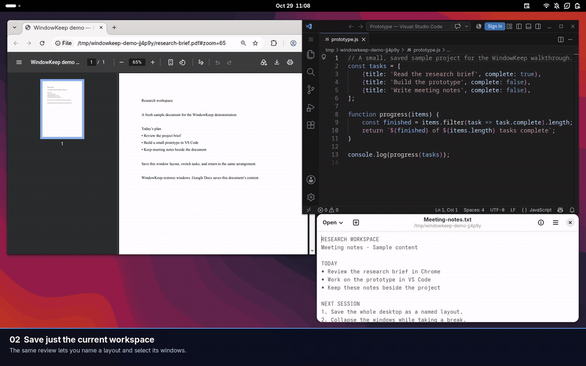
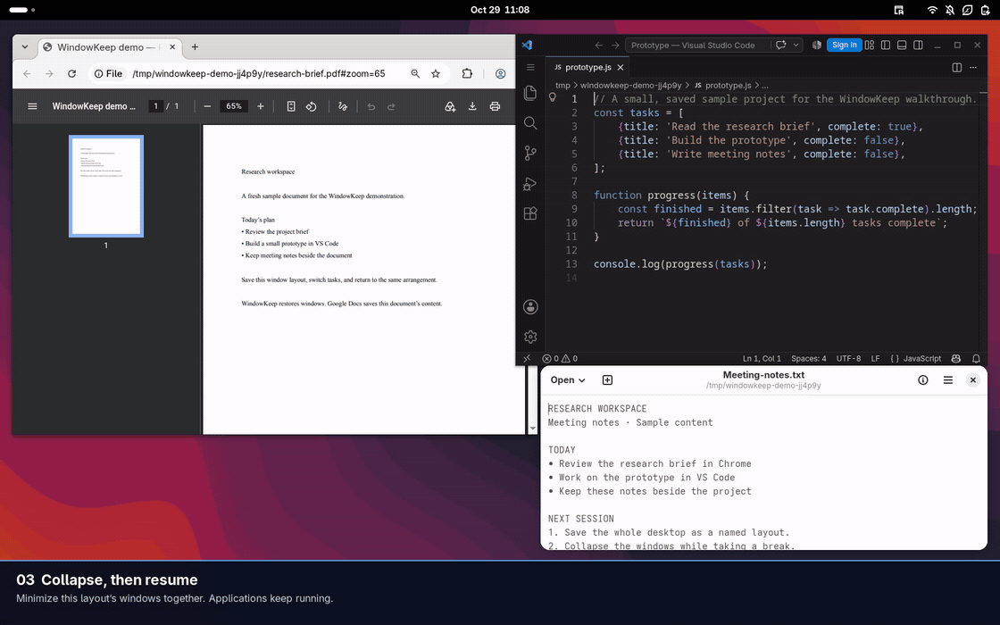
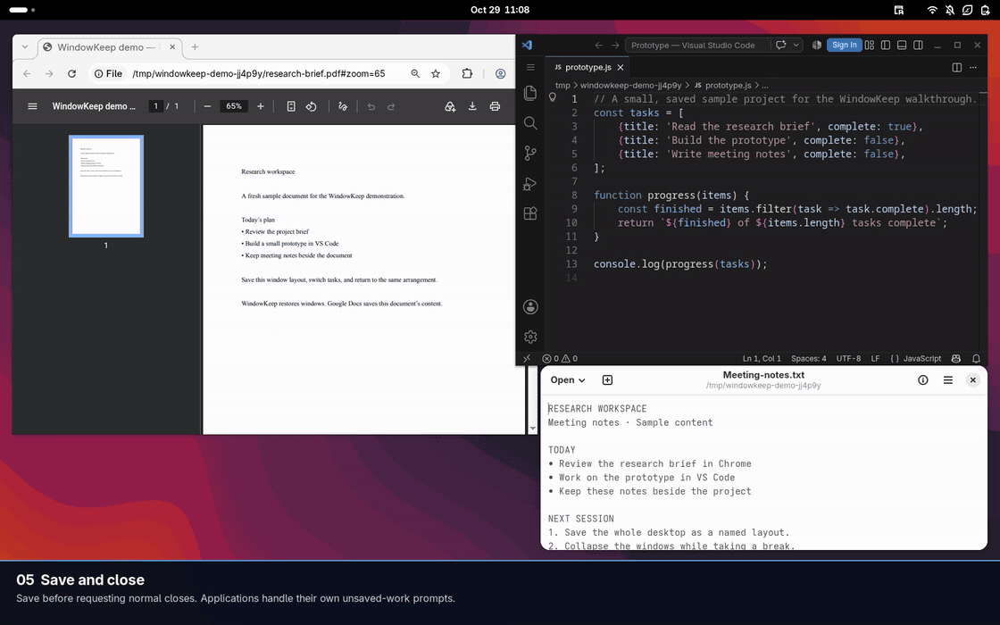
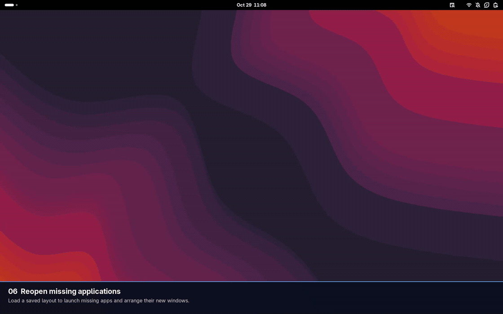
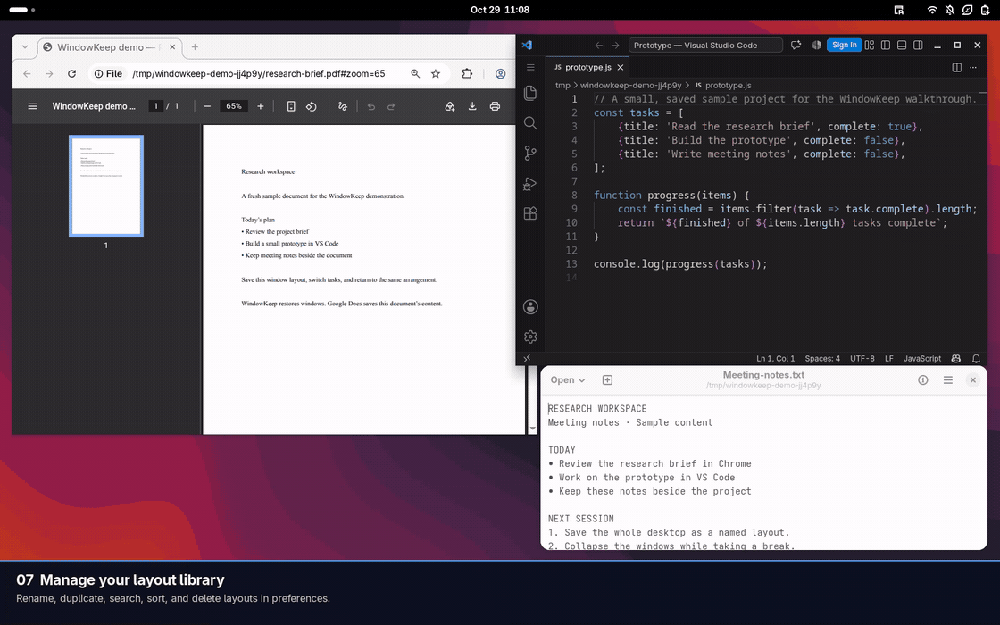
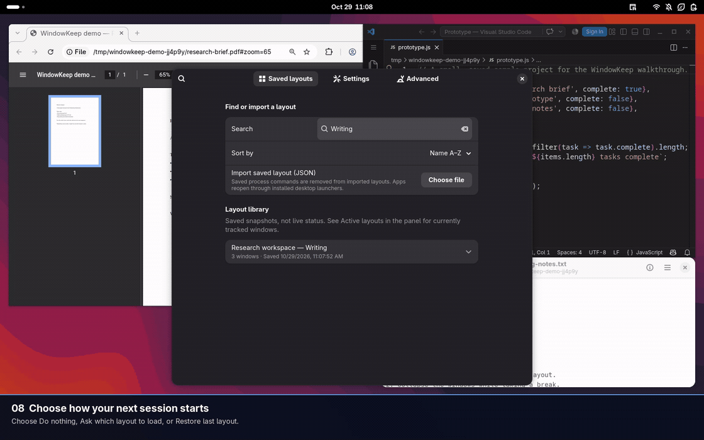
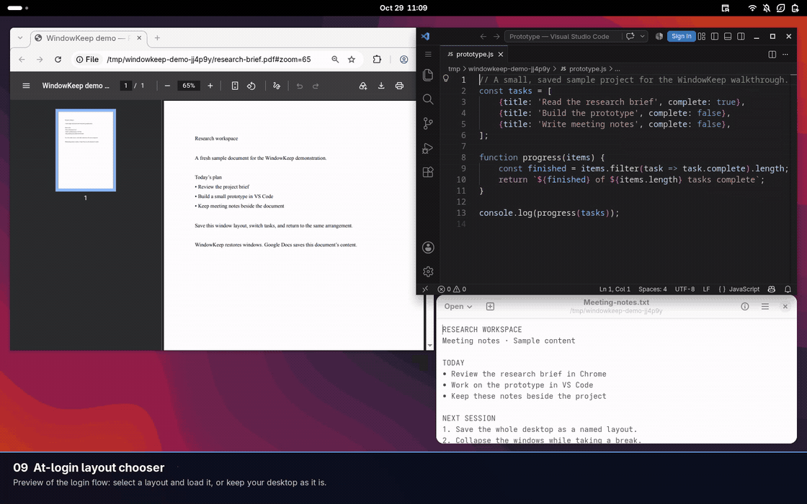
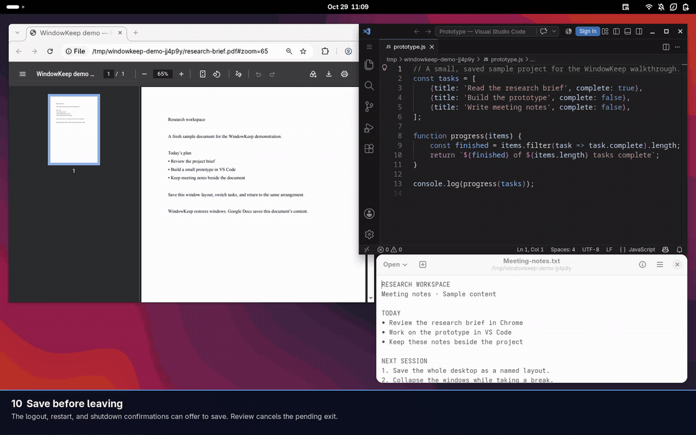
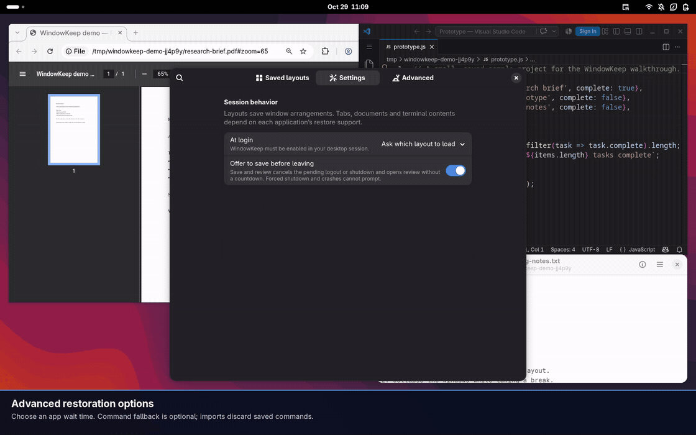

# WindowKeep

WindowKeep is a GNOME Shell extension for saving window arrangements across
workspaces and monitors. Keep named layouts for different projects, choose what
to include, and restore them from the top panel.

**Overview** · [Architecture](docs/ARCHITECTURE.md)

**GNOME 50 · Wayland · GPL-3.0-or-later**

## Save a layout

1. Open WindowKeep in the top panel and choose **Save entire desktop…**.
2. Give the layout a name.
3. Review live previews grouped by workspace. Uncheck windows you do not need.
4. Choose **Save layout**.


Unchecking a window leaves it open. Previews stay in memory; WindowKeep does not
save screenshots of your windows. When a preview is unavailable, an app icon and
fallback label are shown. Individual browser tabs cannot be selected separately.

### Save only the current workspace

Choose **Save this workspace…** to capture the windows on your current workspace.
Review and name the layout in the same way.



## Collapse and resume

**Active layouts** shows layouts with tracked open windows. Expand a layout and
choose **Collapse** to minimize its windows together. Apps keep running and using
resources. Choose **Resume** to bring the layout back.



New windows are not automatically assigned to a layout; save a fresh layout to
include them. Multiple layouts may be active at once.

## Restore an arrangement

Load a saved layout to return matching windows to their saved positions, sizes,
workspaces, monitors and window states. Restoration is best effort; applications
may limit placement or make identical windows difficult to distinguish.


## Save and close

Expand an active layout and choose **Save and close…**. Confirm to save the layout
before requesting normal window closes. Shared windows are flagged before closing.
Applications handle their own unsaved-work prompts; WindowKeep never force-kills
apps.



## Reopen a saved layout

Expand **Saved layouts** in the panel and choose an inactive layout. WindowKeep
reuses matching windows, launches missing apps and attempts to restore their
arrangement.



WindowKeep restores window arrangements. Browser tabs, documents, unsaved work and
terminal contents depend on each application's own save and restore support.

## Find and manage layouts

Open **Manage saved layouts…** for the full library. Search by name and sort by
newest saved, oldest saved, last modified, or name. Expand a layout to rename,
duplicate or delete it. Deletion asks for confirmation.



Dates and window counts help distinguish similar layouts. IDs are available under
**Technical details**. The library contains saved snapshots; live activity is
shown in the panel's **Active layouts** section.

### Export and import

Use the library's **Export** action and **Import saved layout (JSON)** control, or
the command-line interface shown below. Import creates a new layout rather than
overwriting an existing one, and discards saved process commands.


## Choose how to start your session

In **Settings → At login**, choose **Do nothing**, **Ask which layout to load**, or
**Restore last layout**. The extension must be enabled for login behavior to work.



When asked at login, select a saved layout and choose **Load layout**, or choose
**Keep desktop as it is**. Selecting a row alone does not launch applications.
This clip previews the chooser without logging out.



## Save before leaving

Enable **Offer to save before leaving** for a reminder in GNOME's logout, restart
and shutdown confirmation. **Review and save…** cancels the pending exit and opens
review without a countdown. After saving, choose **Done** or explicitly continue
with logout, shutdown or restart.



Closing the review does not log you out. A new save never overwrites an earlier
layout, even when the name matches. Power loss, forced shutdown and commands that
bypass GNOME's confirmation cannot show the reminder. The recording cancels the
exit confirmations; it does not log out or shut down the desktop.

## Advanced restoration options

**Wait for applications** controls how long WindowKeep waits before reporting
missing windows. It does not delay the start of restoration. A partial result
names unresolved windows; it does not keep relaunching them blindly.



**Command fallback** is optional and disabled by default. It allows saved process
arguments to run when no desktop launcher exists. Those arguments may open files
or perform actions. Imported layouts discard process commands and use installed
desktop launchers. They cannot reproduce the original working directory,
environment or application memory.

## Install

You need **GNOME Shell 50 on Wayland**. Build tools are `make`, Python 3, Node.js,
GJS and GLib schema tools. There are no npm dependencies; Python is development
tooling, while the extension and runtime CLI use GJS.

From your checkout:

```bash
make pack
gnome-extensions install --force "$PWD/dist/windowkeep@rithakith.github.io.shell-extension.zip"
```

Save your work, **log out and back in**, then enable WindowKeep:

```bash
gnome-extensions enable windowkeep@rithakith.github.io
```

If you used the earlier Session Atlas builds, disable the old ID before enabling
WindowKeep. Existing saved profiles and preferences are preserved through the
compatibility paths and settings migration.

### Earlier development IDs and troubleshooting

Run the command for the old copy you installed:

```bash
gnome-extensions disable session-atlas@ritzy
gnome-extensions disable session-atlas@rithakith.github.io
```

If GNOME says the new extension does not exist immediately after installation,
log out of the desktop session—not just lock it or close the terminal. GNOME
Wayland cannot reload Shell through Alt+F2 → `r`.

```bash
gnome-extensions info windowkeep@rithakith.github.io
gnome-extensions prefs windowkeep@rithakith.github.io
```


## Capabilities and limits

- **Best-effort matching:** same-app windows with identical or changed titles
  may be difficult to associate with their original layout entries.
- **Monitor changes:** relative geometry helps with changed resolutions; missing
  monitors fall back to primary with a warning.
- **Workspace policy:** secondary-monitor windows remain visible across workspaces
  when GNOME restricts workspaces to the primary monitor. They are still captured.
- **Native tiling:** half-screen arrangements restore as geometry; Mutter tile
  linkage is not recreated. Apps may impose minimum sizes or refuse placement.
- **App content:** tabs, documents, unsaved work and terminal processes require
  application support. Dialogs cannot be launched independently.
- **No continuous autosave:** save or review a layout explicitly. Collapsing apps
  does not suspend them; closing windows may leave background processes running.

This first release targets GNOME 50. It has not yet been approved on GNOME
Extensions. Automated checks run against GNOME 50.5 with two virtual outputs. Physical monitor,
Flatpak and real-login acceptance work remains documented in the
[manual test matrix](docs/TESTING.md).
The clips above are recorded from the real extension in an isolated GNOME 50.5
Wayland desktop, using real VS Code, Chrome and Text Editor windows with sample
content. Chrome displays a PDF exported from a fresh Google Docs sample. Actions
are scripted; the application windows and their restoration are real.

## Privacy, automation and contributing

Profiles are plain JSON under `~/.local/share/session-atlas/profiles/`, respecting
`$XDG_DATA_HOME`. The historical directory keeps existing layouts accessible.
New directories use `0700`, and profile writes use `0600` with atomic replacement.
Titles and saved command arguments may contain private information: inspect and
redact exported layouts before sharing. There is no telemetry or networking code.

For automation, use `scripts/windowkeep`; see the [CLI reference](docs/CLI.md).
For implementation and development, open the [architecture guide](docs/ARCHITECTURE.md).
For GitHub and GNOME Extensions submission, follow the
[publishing guide](docs/PUBLISHING.md).

Have a question, found a bug, or unsure whether something is working as expected?
[Open an issue](https://github.com/rithakith/windowkeep/issues) so we can investigate.
Suggestions and feature requests are welcome too.

Bug reports should include the GNOME version, distribution, monitor/workspace
settings and reproduction steps. Redact private titles, arguments and paths.

[GPL-3.0-or-later](LICENSE) · Copyright 2026 rithakith and contributors.
