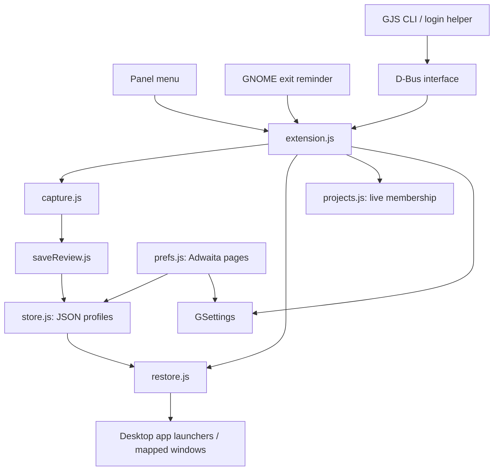
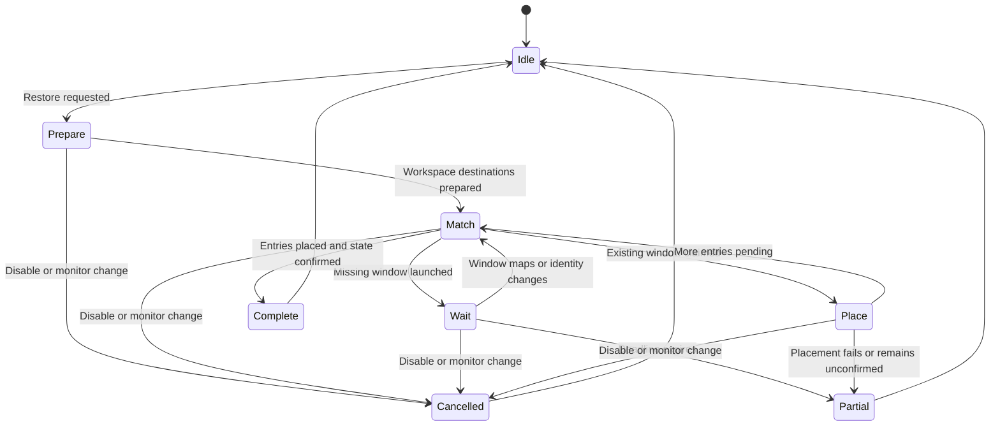

# WindowKeep architecture

| [Overview — features and screenshots](../README.md) | **Architecture — code and design** |
| :--- | :--- |

WindowKeep runs inside GNOME Shell. It captures compositor-visible window
metadata, persists JSON profiles and coordinates best-effort application launches
and placement. Application-internal state remains the application's responsibility.

## Components



| Module | Responsibility |
| --- | --- |
| `extension.js` | Panel and modal flows, notifications, D-Bus export and lifecycle. |
| `capture.js` | Enumerates window actors/workspaces, identities, geometry and state. |
| `saveReview.js` | Draft name, workspace-grouped previews and inclusion selection. |
| `model.js` | Validates imported profiles; computes matching scores and geometry. |
| `store.js` | Atomic JSON persistence and profile CRUD/import/export. |
| `restore.js` | Launch/matching operation, placement, deadlines and cleanup. |
| `projects.js` | Tracks original/restored window membership for active layouts. |
| `shutdownPrompt.js` | Compact reminder that cancels pending exit before review. |
| `login.js` | Creates/removes the optional XDG autostart helper. |
| `settings.js` | Migrates explicit legacy preferences once without overwriting new choices. |
| `prefs.js` | Saved-layout library, general settings and advanced settings. |
| `scripts/windowkeep` | Standalone GJS client for the Shell's D-Bus object. |

## Capture → review → save

The capture path unions compositor actors with workspace window lists and
deduplicates window objects. Secondary-monitor windows are not excluded by
GNOME's primary-only workspace policy. Supported application windows include
normal, dialog, modal-dialog and utility types; shell chrome is filtered out.

The draft records desktop app ID, class/title hints, transient state, stable
sequence, workspace/output assignment, stacking rank, absolute and relative
geometry, maximize/fullscreen/minimize, above/sticky and skip-taskbar state.
It also records a compositor-login token so stable sequences are not mistaken
for cross-login identities.


The review uses **Clutter clones**, not persisted screenshots. Actor destruction
falls back to an app icon; owned signals disconnect when cards are destroyed.
Checkboxes modify only the draft. Save validates the result and writes it
atomically; cancelling review writes nothing. CLI Save is deliberately
non-interactive and does not open the review UI.

## Restore operation



One operation lock covers restore entry points. Existing windows are claimed
before launch; launches are serialized per app. Mapping/identity signals advance
matching. A deadline bounds failure—it is not a sleep used to assume readiness.
An unresolved launch ledger suppresses repeated launches after timeout.

Placement clears obstructing state, moves the window to its monitor and workspace,
applies geometry and saved states, then checks compositor confirmation. Dynamic
workspace updates are blocked only for the operation lifetime and unblocked on
finish/cancellation. Fixed workspace destinations clamp with a warning.


Results include counts, unresolved titles/app IDs, warnings, failures and exact
placed-window membership. A partial result is not reported as full success.
Same-app identities remain heuristic; identical titles and application launch
behavior can prevent reconstruction. Monitor hotplug cancels an in-flight restore.

## Active layout membership

The panel distinguishes tracked live windows from stored snapshots. Current-login
capture tokens and exact windows returned by restore establish membership.
There is no automatic assignment of newly opened windows to a project.


Collapse saves before minimizing. Resume restores the arrangement. Save and close
saves before issuing normal window-close requests, without force-killing apps.
Transients are left to parent applications. Shared membership produces a warning
before close. A layout becomes inactive when no tracked windows remain; the menu
recalculates status when opened.

## Persistence and preferences

Profiles use schema version 1 with provider marker `shell-heuristic-v1`. UUIDs
identify files; names never become file paths. Import validates bounded sizes,
geometry, state fields and command arrays, and assigns a fresh UUID. Writes add a
modification timestamp; older profiles fall back to their creation date.


The live library offers search, sort and profile operations. GSettings holds
configuration, not profile contents:

```text
Schema: org.gnome.shell.extensions.windowkeep
Path:   /org/gnome/shell/extensions/windowkeep/
```

The original `session-atlas` profile directory and legacy settings XML remain
for compatibility. Legacy settings migration copies explicit values once, keeps
explicit WindowKeep choices and leaves original preferences intact.


The At login dropdown presents one behavior, backed by compatibility booleans:
do nothing, ask, or restore last. A batch write keeps the choice coherent. The
XDG helper waits for D-Bus availability and makes one login request. It never
retries a Restore request that might have already launched apps.


Command fallback is explicit opt-in, passes argv directly without shell
interpolation and cannot restore process memory, cwd or environment. Local saved commands are executable behavior. Imports discard command arrays and use installed desktop launchers.

## Exit review and lifecycle


The reminder is attached to GNOME's existing EndSessionDialog. Review cancels the
pending exit and waits for its modal grab to close before opening standalone
review. After saving, an explicit exit action reopens the normal confirmation;
it does not power off automatically. The immediate repeated reminder is skipped.

Objects are created from enable-time paths. Disable destroys owned modals/widgets,
disconnects signals, unexports D-Bus and cancels restore sources. No monkey-patching
is used. Some Shell integration methods are feature-dependent implementation
interfaces and need retesting when GNOME changes; only GNOME 50 is declared.

## Build and verify

```bash
make test                    # syntax, schemas, migration, geometry and storage
scripts/nested-smoke.sh       # actual isolated GNOME 50 compositor tests
make pack                    # runtime ZIP, not the source tree
make pot                     # translation template
```

To refresh the documentation's real screenshots while running the isolated suite:

```bash
WINDOWKEEP_DOC_SCREENSHOTS=1 scripts/nested-smoke.sh
```

Screenshot mode uses the configured desktop wallpaper and dark mode; it opens
and cancels native exit confirmations without confirming an exit.
The harness uses temporary XDG directories, its own bus and disposable windows.
It checks actual restores, project actions, review/selection, preferences, login
choice and cleanup. It does not execute real shutdown actions. See
[TESTING.md](TESTING.md) for coverage and
remaining acceptance work. Screenshots are UI evidence; diagrams describe logic,
not proof of every path's runtime behavior.

## Native session-management path

Capture, persistence and restoration are separate. A future provider can store
opaque native application-session tokens when compositor/client support permits.
The experimental protocol requires client opt-in and pre-map restore requests;
Shell cannot synthesize that participation for arbitrary apps. Prevent double
restoration when switching to a native manager.
